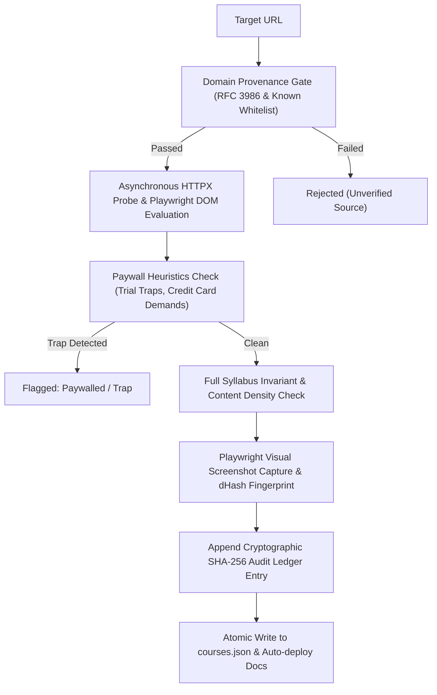

# CoursePulse

> **Autonomous, self-updating, anti-paywall open course directory with cryptographic verification and visual proof.**

CoursePulse continuously audits top-tier university and industry open-learning courses, asserting full syllabus accessibility, zero payment walls, zero credit card traps, and verified free learning materials. Every course in this directory is validated via headless Playwright inspections and an immutable cryptographic audit ledger.

## Real-Time Directory Telemetry

- **Active Audited Courses**: `20` / `20`
- **Courses with Free Certificates/Badges**: `15`
- **Last Verified Pipeline Run**: `2026-10-24T12:00:00.000000+00:00`
- **Paywall Invariant**: `100% Free Guaranteed` (Full syllabus, zero credit card required, zero trial bait)
- **Visual Proof Invariant**: Every active course contains a visual rendering audit in `docs/screenshots/`

---

## Core Guarantees & Verification Invariants

Unlike commercial aggregate registries filled with affiliate links and 7-day trial traps, CoursePulse enforces strict mathematical and browser-level invariants:

1. **Zero Hidden Paywalls**: No paywalls, subscription models (e.g. Coursera Plus required to complete), or payment card inputs at registration.
2. **Full Curriculum Accessibility**: Every reading, lecture, problem set, and module is 100% unlocked from day one.
3. **Anti-Scam Domain Provenance**: Courses are strictly sourced from verified academic, governmental, or reputable non-profit institutions.
4. **Visual Difference Hashing**: Headless Playwright captures render snapshots and monitors structural changes with 64-bit difference hashing (`dhash`).

---

## Directory Catalog by Category

### Artificial Intelligence (6)

| Course | Institution | Platform | Level | Duration | Credential | Materials | Proof |
| :--- | :--- | :--- | :---: | :---: | :--- | :--- | :---: |
| [AI Python for Beginners](https://www.deeplearning.ai/short-courses/ai-python-for-beginners/) | DeepLearning.AI | DeepLearning.AI | Beginner | 10h | **[Accomplishment]** | `Video Lessons` `Jupyter Workspace` `Free Statement of Accomplishment` | [Visual Proof](docs/screenshots/deeplearningai-ai-python.png) |
| [CS50AI: Introduction to Artificial Intelligence with Python](https://cs50.harvard.edu/ai/) | Harvard University | Harvard Online / CS50 | Intermediate | 90h | **[Free Cert]** | `Algorithms & AI Theory` `Hands-on Python Projects` `Automated Grading` | [Visual Proof](docs/screenshots/harvard-cs50ai.png) |
| [Deep Learning with TensorFlow & Keras](https://www.kaggle.com/learn/intro-to-deep-learning) | Kaggle | Kaggle Learn | Intermediate | 4h | **[Free Cert]** | `TensorFlow Cloud Notebooks` `Automated Feedback` `Free Certificate` | [Visual Proof](docs/screenshots/kaggle-deep-learning.png) |
| [Elements of AI: Introduction to Artificial Intelligence](https://www.elementsofai.com/) | University of Helsinki & Reaktor | Elements of AI | Beginner | 30h | **[Free Cert]** | `Interactive Visual Modules` `Automated Exercises` `Peer Reviews` | [Visual Proof](docs/screenshots/helsinki-elements-of-ai.png) |
| [Introduction to Generative AI Learning Path](https://www.cloudskillsboost.google/course_templates/536) | Google Cloud | Google Cloud Skills Boost | Beginner | 5h | **[Free Badge]** | `Google Engineering Videos` `Reading Documents` `Quiz` | [Visual Proof](docs/screenshots/google-cloud-intro-generative-ai.png) |
| [Machine Learning with Python Certification](https://www.freecodecamp.org/learn/machine-learning-with-python/) | freeCodeCamp | freeCodeCamp.org | Intermediate | 300h | **[Free Cert]** | `TensorFlow Lab Notebooks` `5 ML Capstone Projects` `Free Verifiable Certificate` | [Visual Proof](docs/screenshots/fcc-machine-learning-python.png) |

### Computer Science (5)

| Course | Institution | Platform | Level | Duration | Credential | Materials | Proof |
| :--- | :--- | :--- | :---: | :---: | :--- | :--- | :---: |
| [CS50P: Introduction to Programming with Python](https://cs50.harvard.edu/python/) | Harvard University | Harvard Online / CS50 | Beginner | 80h | **[Free Cert]** | `Video Lectures` `Automated Testing Suite (check50)` `Coding Exercises` | [Visual Proof](docs/screenshots/harvard-cs50p.png) |
| [CS50x: Introduction to Computer Science](https://cs50.harvard.edu/x/) | Harvard University | Harvard Online / CS50 | Beginner | 120h | **[Free Cert]** | `Full Video Lectures` `Interactive Problem Sets` `Cloud IDE` | [Visual Proof](docs/screenshots/harvard-cs50x.png) |
| [Introduction to Computer Science and Programming in Python](https://ocw.mit.edu/courses/6-0001-introduction-to-computer-science-and-programming-in-python-fall-2016/) | Massachusetts Institute of Technology (MIT) | MIT OpenCourseWare | Beginner | 60h | *(Audit Only)* | `Full Lecture Videos` `Lecture Transcripts` `Problem Sets with Solutions` | [Visual Proof](docs/screenshots/mit-ocw-6-0001.png) |
| [Python Essentials 1](https://www.netacad.com/courses/programming/pcap-programming-essentials-python) | Cisco Networking Academy & OpenEDG | Cisco Networking Academy | Beginner | 30h | **[Free Badge]** | `Browser Sandbox Environment` `Quizzes & Module Tests` `Cisco NetAcad Digital Badge` | [Visual Proof](docs/screenshots/cisco-netacad-python-essentials.png) |
| [Python for Beginners Learning Path](https://learn.microsoft.com/en-us/training/paths/python-language/) | Microsoft | Microsoft Learn | Beginner | 12h | **[Free Badge]** | `Interactive Cloud Sandbox` `Code Knowledge Checks` `Verifiable Profile Badge` | [Visual Proof](docs/screenshots/microsoft-learn-python.png) |

### Data Science (3)

| Course | Institution | Platform | Level | Duration | Credential | Materials | Proof |
| :--- | :--- | :--- | :---: | :---: | :--- | :--- | :---: |
| [Intro to Machine Learning](https://www.kaggle.com/learn/intro-to-machine-learning) | Kaggle | Kaggle Learn | Beginner | 4h | **[Free Cert]** | `Runnable GPU Notebooks` `Automated Code Checks` `Free Certificate` | [Visual Proof](docs/screenshots/kaggle-intro-to-machine-learning.png) |
| [Introduction to MongoDB & Document Databases](https://learn.mongodb.com/learning-paths/introduction-to-mongodb) | MongoDB | MongoDB University | Beginner | 15h | **[Free Badge]** | `Interactive Video Lectures` `Cloud Atlas Lab Sandbox` `Verifiable MongoDB Badge` | [Visual Proof](docs/screenshots/mongodb-university-intro.png) |
| [Scientific Computing with Python Certification](https://www.freecodecamp.org/learn/scientific-computing-with-python/) | freeCodeCamp | freeCodeCamp.org | Intermediate | 300h | **[Free Cert]** | `Interactive Lessons` `5 Real-world Python Projects` `Free Verifiable Certificate` | [Visual Proof](docs/screenshots/fcc-scientific-computing-python.png) |

### Mathematics & Algorithms (3)

| Course | Institution | Platform | Level | Duration | Credential | Materials | Proof |
| :--- | :--- | :--- | :---: | :---: | :--- | :--- | :---: |
| [Algorithms: Design and Analysis](https://online.stanford.edu/courses/soe-ycscs1-algorithms-design-and-analysis-part-1) | Stanford University | Stanford Online / Tim Roughgarden | Intermediate | 80h | *(Audit Only)* | `Full Stanford Video Lectures` `Programming Problem Sets` `Lecture Notes` | [Visual Proof](docs/screenshots/stanford-algorithms-specialization.png) |
| [Introduction to Algorithms](https://ocw.mit.edu/courses/6-006-introduction-to-algorithms-spring-2020/) | Massachusetts Institute of Technology (MIT) | MIT OpenCourseWare | Intermediate | 90h | *(Audit Only)* | `Spring 2020 Video Lectures` `Recitations` `Problem Sets` | [Visual Proof](docs/screenshots/mit-ocw-6-006.png) |
| [Linear Algebra (Gilbert Strang)](https://ocw.mit.edu/courses/18-06-linear-algebra-spring-2010/) | Massachusetts Institute of Technology (MIT) | MIT OpenCourseWare | Intermediate | 75h | *(Audit Only)* | `35 Video Lectures` `Homework & Exam Solutions` `Instructor Notes` | [Visual Proof](docs/screenshots/mit-ocw-18-06.png) |

### Web Development (3)

| Course | Institution | Platform | Level | Duration | Credential | Materials | Proof |
| :--- | :--- | :--- | :---: | :---: | :--- | :--- | :---: |
| [Full Stack Open: Deep Dive Into Modern Web Development](https://fullstackopen.com/en/) | University of Helsinki | Full Stack Open | Intermediate | 180h | **[Free Cert]** | `14 Comprehensive Parts` `Hands-on Submission Grader` `Discord Community` | [Visual Proof](docs/screenshots/helsinki-fullstackopen.png) |
| [Responsive Web Design Certification](https://www.freecodecamp.org/learn/2022/responsive-web-design/) | freeCodeCamp | freeCodeCamp.org | Beginner | 300h | **[Free Cert]** | `Interactive Browser Sandbox` `15 Practice Projects` `5 Certification Projects` | [Visual Proof](docs/screenshots/fcc-responsive-web-design.png) |
| [The Odin Project: Foundations Path](https://www.theodinproject.com/paths/foundations/courses/foundations) | The Odin Project | The Odin Project | Beginner | 100h | *(Audit Only)* | `Curated Learning Paths` `Real Portfolio Projects` `Active Discord Community` | [Visual Proof](docs/screenshots/the-odin-project-foundations.png) |

---

## Inspection Engine & Anti-Trap Architecture

The automated inspector (`src/inspector.py` & `src/paywall_detector.py`) checks prospective leads across several defense layers:



### Paywall Trap Detection Signals

- **Subscription Bait**: Keywords like `"7-day free trial"`, `"subscription will renew automatically"`, `"billed annually"` flag instant disqualification.
- **Credit Card Gates**: Any prompt requesting cardholder details, billing addresses, or payment gateways for course enrollment fails verification.
- **Locked Module Selectors**: Elements matching `.module-locked`, `[aria-label*='locked']`, or padlock iconography indicate an incomplete free audit and prompt human review.

---

## Running the Pipeline Locally

### Prerequisites
- Python 3.12+
- Headless Chromium (`playwright install chromium`)

```bash
# Clone the repository
git clone https://github.com/CoursePulse/free-course-tracker.git
cd free-course-tracker

# Install dependencies
pip install -r requirements.txt
playwright install chromium

# Run full validation and inspection pipeline
python -m src.main

# Run test suite
pytest -v
```

---

## License & Integrity Pledge

All course content, trademarks, and curricula belong to their respective universities, foundations, and authors. CoursePulse is an open-source, non-profit community project built for students, self-taught engineers, and lifelong learners.
